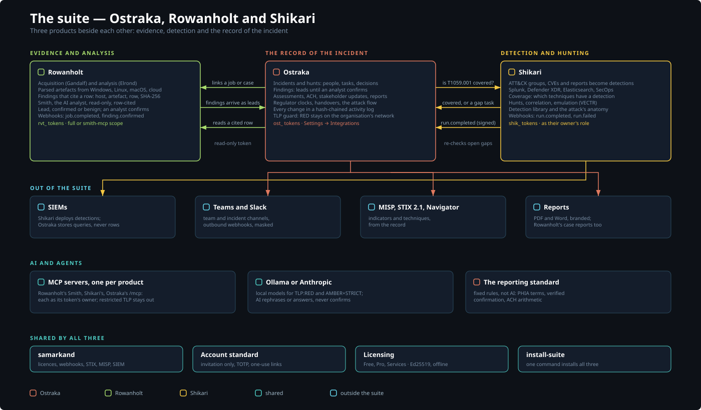
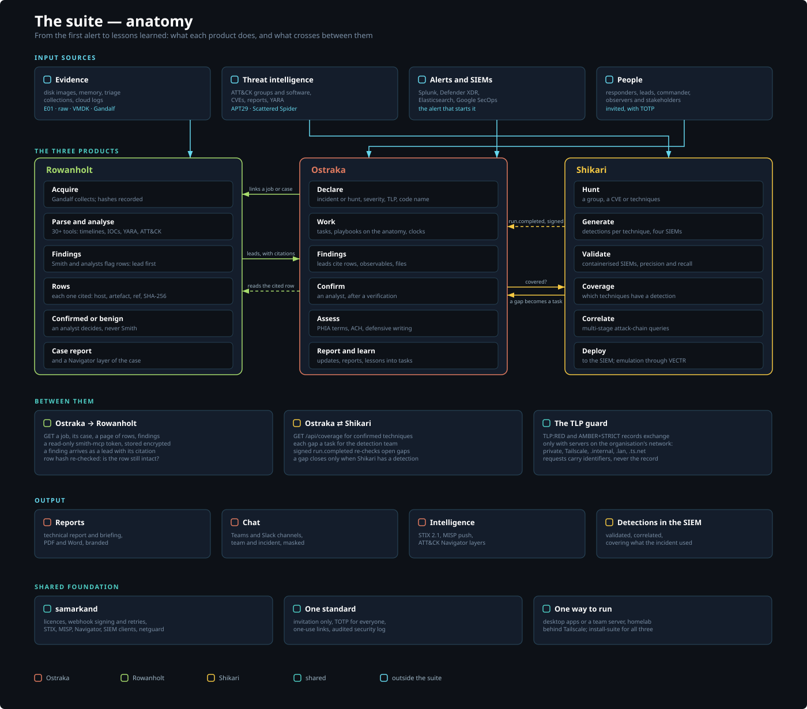

# The suite

Ostraka, Rowanholt and Shikari are three products that sit beside each other:

- **Rowanholt** holds the evidence and its analysis.
- **Shikari** writes the detections and runs the hunts.
- **Ostraka** keeps the record of the incident: the people, the work, the decisions and the assessments.

None of them duplicates another. This folder is the same in all three repositories.





Each product keeps its own colour: Ostraka is red ochre, Rowanholt leaf green and Shikari gold. Teal marks what they share. To redraw both after changing `draw.py`, run:

```sh
python3 docs/suite/draw.py
```

Copy the folder to the other two repositories after redrawing.

## Installing all three

`scripts/install-suite.sh` (macOS and Linux) and `scripts/install-suite.ps1` (Windows) install or upgrade all three from their latest releases with one command. Each fetches every product's own installer from that release's tag and runs it, and that installer checks its package against the release's `SHA256SUMS`.

```sh
curl -fsSLO https://raw.githubusercontent.com/cmdaltr/ostraka/main/scripts/install-suite.sh
sh install-suite.sh
```

```powershell
Invoke-WebRequest https://raw.githubusercontent.com/cmdaltr/ostraka/main/scripts/install-suite.ps1 -OutFile install-suite.ps1
powershell -ExecutionPolicy Bypass -File install-suite.ps1
```

Options:

- `--only ostraka,shikari` or `--skip rowanholt` installs some of the three.
- `--launch` opens each product once it's installed.
- `--dry-run` shows what would be installed without installing anything.

The PowerShell script takes the same options as `-Only`, `-Skip`, `-Launch` and `-DryRun`.
